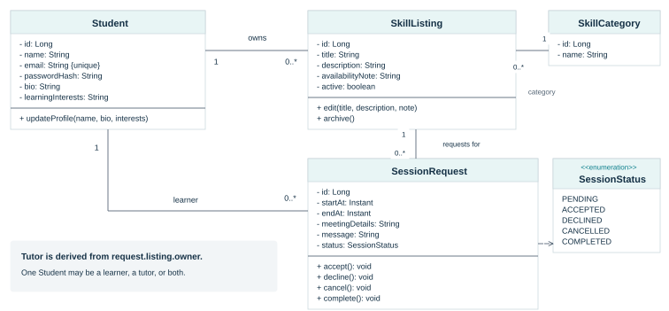

# SkillSwap - Dardanian Devs

SWEN383 Project Part 1. Team: Redon, Rinor, Granit, Leanda.
Prepared for Professor Valon Raca. Design date: 13 October 2026.

## Contents

Each diagram has an editable PlantUML source (`.puml`) and a vector image (`.svg`).

| ID | File stem | Purpose |
| --- | --- | --- |
| CD-01 | [01-domain-class.svg](01-domain-class.svg) / [source](01-domain-class.puml) | Core classes, types, responsibilities, and multiplicities |
| SD-01 | [02-publish-skill.svg](02-publish-skill.svg) / [source](02-publish-skill.puml) | Publish a skill offer with validation |
| SD-02 | [03-request-session.svg](03-request-session.svg) / [source](03-request-session.puml) | Request a session on an active listing |
| SD-03 | [04-accept-session.svg](04-accept-session.svg) / [source](04-accept-session.puml) | Accept a request with participant locking |
| SD-04 | [05-cancel-or-complete.svg](05-cancel-or-complete.svg) / [source](05-cancel-or-complete.puml) | Guard cancellation and completion |

SVG files are ready to view in a browser or include in a document. PlantUML files are the editable UML sources; regenerate their images with a PlantUML renderer after editing. The supplied SVGs use a custom typeset layout; another renderer will position the same model differently.

## Domain diagram preview

## Proposed stack and patterns

Java, Spring Boot, Thymeleaf, Spring Security, Spring Data JPA, PostgreSQL, Maven, and JUnit. One server-rendered web application and one database.

Planned patterns: Service Layer, Repository, and Unit of Work. A small status enum and guarded domain methods implement the fixed session lifecycle. We are not proposing a separate GoF State class hierarchy.

## UML reading notes

- Domain diagram: `-` means private, `+` means public, `1` means exactly one, and `0..*` means zero or more.
- Association reference fields are represented by lines rather than repeated as attributes. The tutor is `request.listing.owner`.
- Sequence diagram participant names prefixed with `:` are unnamed instances of the given class. Repository labels wrap across two lines for legibility.
- Solid arrows are calls; dashed arrows are replies. `alt` sections describe mutually exclusive paths. Notes describe transaction boundaries and outcomes where framework activity is omitted.
- The figures are proposed designs, not execution traces or proof of completed implementation.

## Shared contracts

- A student may both teach and learn. Only active skill offers are searchable; learning interests live in profile text.
- SessionRequest links one learner to one skill listing. It begins PENDING. The learner cannot own that listing.
- Times and participants are immutable after creation. Store times as instants; label the configured campus timezone in forms and views.
- PENDING -> ACCEPTED: tutor only, before start, no accepted overlap for either student.
- PENDING -> DECLINED: tutor only. PENDING -> CANCELLED: learner only.
- ACCEPTED -> CANCELLED: either participant, before start.
- ACCEPTED -> COMPLETED: tutor only, at or after end.
- DECLINED, CANCELLED, and COMPLETED are terminal. Invalid or repeated actions do not change state.
- Pending requests do not reserve time. Intervals are [start, end): overlap is existing.start < proposed.end AND proposed.start < existing.end.
- Archive a listing rather than deleting it. Archive blocks new requests but retains all existing requests.
- A service transaction encloses each state-changing operation. Successful browser responses occur only after commit; errors roll back.
- Request creation takes a shared lock on its listing; archive takes a write lock. This serializes their race at the database.
- Acceptance first reads immutable participant IDs, locks both Student rows in ascending ID order, then reloads the SessionRequest with a write lock. Recheck actor, PENDING, future start, and accepted overlaps. Use READ COMMITTED so the post-lock query sees committed earlier bookings. Save ACCEPTED and commit, or roll back on conflict.
- All acceptances use this lock protocol. Cancellation, decline, and completion lock their request before checking and changing it. Lock timeout/deadlock errors roll back and allow a safe user retry.
- Controller identity comes from the authenticated principal. Do not trust owner IDs from submitted forms.

## Scope exclusions

No payments, credits, ratings, chat, video calling, AI matching, group classes, recurring sessions, calendar/email integrations, university SSO, native mobile apps, or public admin dashboard.

## Technical references

- [UML 2.5.1 specification](https://www.omg.org/spec/UML/2.5.1/About-UML) - Object Management Group.
- [Serving Web Content with Spring MVC](https://spring.io/guides/gs/serving-web-content/) - Spring.
- [Service Layer](https://martinfowler.com/eaaCatalog/serviceLayer.html) - Martin Fowler.
- [Repository](https://martinfowler.com/eaaCatalog/repository.html) - Martin Fowler catalog.
- [Unit of Work](https://martinfowler.com/eaaCatalog/unitOfWork.html) - Martin Fowler.
- [Transactionality; Locking](https://docs.spring.io/spring-data/jpa/reference/jpa/transactions.html) - Spring Data JPA.
- [Explicit Locking](https://www.postgresql.org/docs/current/explicit-locking.html) - PostgreSQL.
